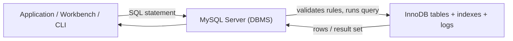

# 00 — The database mental model and your first workflow

## 1. What a database is

A **database** is an organised, durable collection of facts. A customer name, an invoice date, stock quantity, course registration, and payment are facts. A database keeps them in a form that can be searched, changed, protected, and shared safely.

A spreadsheet is excellent for a small, personal list. A database becomes better when many facts are connected, many people/programs use the data, rules matter, or a failure must not lose/duplicate money. Database data is usually stored on disk; it survives after the program that used it closes.

## 2. Database vs DBMS vs RDBMS

| Word | Meaning | Example |
|---|---|---|
| Database | The data and its structure | `shop` with `customers`, `orders`, `products` |
| DBMS | Software that stores/manages databases | MySQL Server, MongoDB, PostgreSQL |
| RDBMS | A DBMS that stores related data in tables (relations) and uses relational rules | MySQL, PostgreSQL, SQL Server |
| SQL | The language used to ask/manage a relational database | `SELECT * FROM products;` |
| MySQL | A particular RDBMS that understands a MySQL dialect of SQL | MySQL Server 8.4 |

A **table** is like a well-defined sheet: columns describe attributes and rows describe individual facts. Unlike a loose spreadsheet, a relational database can enforce that every order has a real customer, every email is unique, and a price cannot be negative.



## 3. Why relational design matters

Suppose each order row repeats `customer_name`, `customer_email`, and `customer_address`. A customer who moves creates a problem: which old rows should change? This is an **update anomaly**. Instead, keep the customer once in `customers`, then store the customer ID in each `orders` row. The foreign key makes the link explicit.

Relational ideas you will use constantly:

- **Entity:** a thing we track, such as a customer or product.
- **Attribute:** a property, such as an email or unit price.
- **Row/tuple/record:** one instance of an entity.
- **Primary key (PK):** a value that uniquely identifies a row.
- **Foreign key (FK):** a column that references a key in another table.
- **Relationship:** the business connection between entities.
- **Constraint:** a database-enforced rule.
- **Index:** an extra lookup structure that can make reads faster.

## 4. Types of database systems

- **Relational:** tables and SQL; strong transactions and relationships. Examples: MySQL, PostgreSQL, SQL Server.
- **Document:** JSON-like records; flexible shapes. Examples: MongoDB, Couchbase.
- **Key-value:** lookup by key; excellent for cache/session workloads. Examples: Redis, DynamoDB.
- **Wide-column:** huge distributed tables. Examples: Cassandra, HBase.
- **Graph:** relationships are the main concern. Examples: Neo4j, Neptune.
- **Time-series:** measurements indexed by time. Examples: InfluxDB, Timescale.

No type is universally best. Start with the query patterns, consistency requirements, volume, operational skills, and cost—not fashion.

## 5. Install and verify MySQL on Windows

1. Download MySQL Community Server / MySQL Installer from the official MySQL downloads site. Choose a supported server release and record the root password in a password manager.
2. Install **MySQL Server** and optionally **MySQL Workbench**. During configuration, keep the service enabled, use a strong root password, and note the port (normally `3306`).
3. Start MySQL Workbench. Create a connection to `localhost`, port `3306`, user `root` (or a personal admin user). Test it.
4. In a query tab, run:

```sql
SELECT VERSION() AS mysql_version, CURRENT_USER() AS connected_as;
SHOW VARIABLES LIKE 'sql_mode';
```

`VERSION()` confirms the server. `CURRENT_USER()` tells you the MySQL account whose privileges are active. `sql_mode` affects how strictly MySQL accepts data; do not silently ignore it.

## 6. Workbench workflow

Workbench is a client; the MySQL Server is the database engine. The left **Schemas** pane lists databases/tables; the SQL editor sends highlighted text or the current statement to the server; the result grid shows returned rows; the Output panel shows errors/warnings. The same SQL can be executed from the `mysql` command-line client or an application.

Useful habits:

- End statements with `;`. This tells the client where a statement ends.
- Select only the query you mean to execute before clicking the lightning icon.
- Save scripts as `.sql` and put the objective in a comment at the top.
- Read the full error. It often names the table, column, constraint, or line.
- Use one scratch database for experiments. Do not experiment in a production schema.

## 7. A repeatable SQL thinking process

Before typing SQL, say the question in plain English: “show paid orders from this month, newest first.” Then identify:

1. **Source:** which table(s) contain the facts?
2. **Grain:** one returned row represents what—an order, customer, product, day?
3. **Filter:** which rows are allowed?
4. **Calculation:** which values are derived?
5. **Shape:** do we need grouping, joining, sorting, or a limit?
6. **Safety:** does this change data? Is a transaction/backup needed?

For a `SELECT`, SQL is written in an order that reads well, but logically processed approximately as follows:


This explains why an alias made in `SELECT` usually cannot be used in `WHERE`: `WHERE` happens earlier.

## 8. Setup script used throughout this guide

Run this once. It creates a safe learning database and deliberately does **not** grant it to anyone.

```sql
DROP DATABASE IF EXISTS mysql_mastery_lab;
CREATE DATABASE mysql_mastery_lab
  CHARACTER SET utf8mb4
  COLLATE utf8mb4_0900_ai_ci;
USE mysql_mastery_lab;

SELECT DATABASE() AS current_database;
```

Line by line:

- `DROP DATABASE IF EXISTS` removes a previous practice database without error if it is absent. It is destructive; never point it at a real database.
- `CREATE DATABASE` makes a new namespace for tables.
- `utf8mb4` stores full Unicode, including many emoji and non-Latin scripts. Prefer it for new applications.
- The collation controls comparison/sorting rules. Choose deliberately for your language and case/accent requirements.
- `USE` makes later unqualified table names refer to this database.
- `DATABASE()` is a guard rail: it displays where you are.

## 9. Your first command set

```sql
SHOW DATABASES;
SHOW TABLES;
SELECT DATABASE();
SHOW CREATE DATABASE mysql_mastery_lab;
```

`SHOW` commands inspect server metadata. They are a good first response when you are unsure what exists.

**Checkpoint:** Explain, without looking, why SQL and MySQL are not the same thing; what a primary key does; and how a Workbench query reaches a table.

