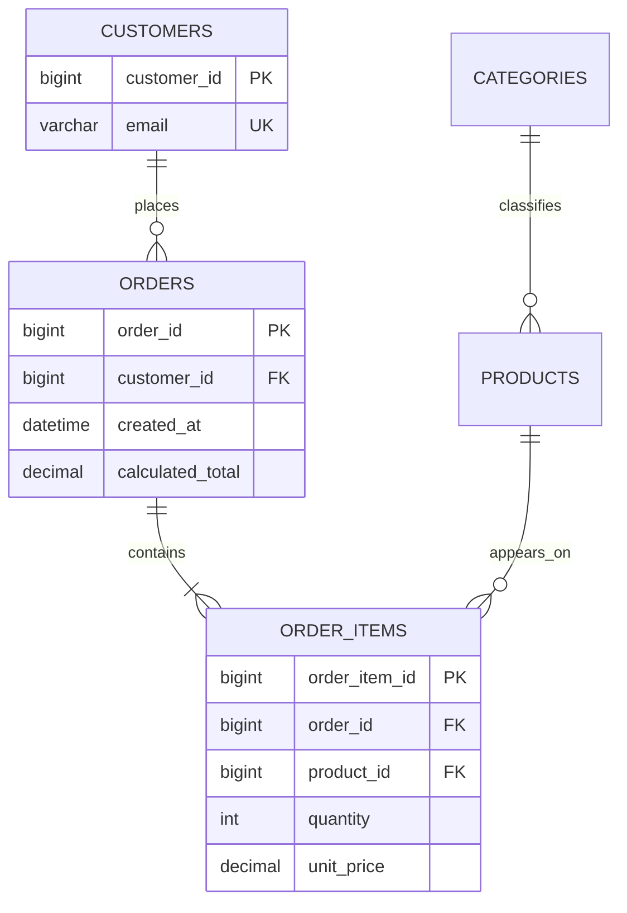

# 05 — Data modelling, keys, normalisation, and relationships

Great SQL cannot rescue a confused model. A data model is a precise agreement about what each table represents, how rows relate, and which facts are allowed.

## 1. Model from business rules

Take a short narrative: “A customer can place many orders. An order has one customer. Each order has one or more products. Products can be on many orders. An order records the price at the time it was bought.”

Extract nouns (candidate entities), verbs (relationships), attributes, optionality, and rules. Then state the row grain:

- `customers`: one row per customer.
- `products`: one row per sellable product.
- `orders`: one row per order/check-out.
- `order_items`: one row per product line on an order—not one row per order.



## 2. Relationship types

- **One-to-one:** one user has one profile. Often keep it as one table unless permissions, lifecycle, or optional large data justify splitting.
- **One-to-many:** one customer has many orders. Put the parent key (`customer_id`) in the child table (`orders`).
- **Many-to-many:** a product appears on many orders and an order has many products. Create a bridge/junction table (`order_items`) containing the two foreign keys plus relationship attributes such as quantity and purchased price.
- **Self-reference:** employee manages employee; category has parent category. A foreign key can point to the same table.

## 3. Primary, candidate, natural, and surrogate keys

A **candidate key** is any minimal set of columns that uniquely identifies a row. One candidate is selected as the primary key. A **natural key** has business meaning (email, ISO country code); a **surrogate key** is a generated identifier (often integer). Many production tables use a surrogate PK plus `UNIQUE` constraints for true business identities.

```sql
CREATE TABLE customers (
  customer_id BIGINT UNSIGNED NOT NULL AUTO_INCREMENT,
  email VARCHAR(254) NOT NULL,
  first_name VARCHAR(100) NOT NULL,
  last_name VARCHAR(100) NOT NULL,
  PRIMARY KEY (customer_id),
  UNIQUE KEY uq_customers_email (email)
) ENGINE=InnoDB;
```

Do not expose a sequential integer as an authorization boundary in an application; check ownership/permissions too. A primary key does not itself make the rest of a row valid.

## 4. Foreign keys: integrity, not just joins

```sql
CREATE TABLE orders (
  order_id BIGINT UNSIGNED NOT NULL AUTO_INCREMENT,
  customer_id BIGINT UNSIGNED NOT NULL,
  status ENUM('pending','paid','shipped','cancelled') NOT NULL DEFAULT 'pending',
  created_at DATETIME NOT NULL DEFAULT CURRENT_TIMESTAMP,
  PRIMARY KEY (order_id),
  KEY ix_orders_customer_id (customer_id),
  CONSTRAINT fk_orders_customer
    FOREIGN KEY (customer_id) REFERENCES customers (customer_id)
    ON UPDATE RESTRICT
    ON DELETE RESTRICT
) ENGINE=InnoDB;
```

The foreign key rejects an order that refers to no customer. Parent/child data types must be compatible. Index the referencing columns (MySQL may create an index automatically; name/control it yourself for clarity). `RESTRICT` says “do not delete/update a referenced parent.”

Common actions:

- `RESTRICT`/`NO ACTION`: block the parent action if children exist.
- `CASCADE`: propagate parent deletion/update to children. Appropriate only when children have no independent life (e.g., a disposable cart’s lines).
- `SET NULL`: keep children but remove the relationship; FK column must be nullable.

Never choose `CASCADE` merely to silence a delete error. Draw the full deletion path and decide whether historical data should remain.

## 5. Normalisation: reduce contradictory facts

Normalisation is a set of design checks that reduce duplication and anomalies.

- **1NF:** values are atomic for their intended use; rows are not repeating groups such as `product_1`, `product_2` columns.
- **2NF:** in a table with a composite key, non-key facts depend on the full key, not only part of it.
- **3NF:** non-key facts depend on the key, the whole key, and nothing but the key—not on other non-key facts.

Bad: `orders(order_id, customer_email, customer_city, product1, product2)`. Good: `customers`, `orders`, `products`, and `order_items`. The good model has controlled joins, while the bad model has conflicting copies.

Do not normalize blindly. A deliberate denormalized value can be valid for a measured performance need, snapshot/history (purchase-time `unit_price`), or precomputed report. Document the source of truth and how it stays correct.

## 6. Full order schema

```sql
CREATE TABLE categories (
  category_id BIGINT UNSIGNED NOT NULL AUTO_INCREMENT,
  name VARCHAR(100) NOT NULL,
  PRIMARY KEY (category_id),
  UNIQUE KEY uq_categories_name (name)
) ENGINE=InnoDB;

ALTER TABLE products
  ADD COLUMN category_id BIGINT UNSIGNED NULL,
  ADD CONSTRAINT fk_products_category
    FOREIGN KEY (category_id) REFERENCES categories(category_id)
    ON DELETE SET NULL;

CREATE TABLE order_items (
  order_item_id BIGINT UNSIGNED NOT NULL AUTO_INCREMENT,
  order_id BIGINT UNSIGNED NOT NULL,
  product_id BIGINT UNSIGNED NOT NULL,
  quantity INT UNSIGNED NOT NULL,
  unit_price DECIMAL(10,2) NOT NULL,
  PRIMARY KEY (order_item_id),
  UNIQUE KEY uq_order_items_order_product (order_id, product_id),
  KEY ix_order_items_product_id (product_id),
  CONSTRAINT chk_order_items_quantity CHECK (quantity > 0),
  CONSTRAINT chk_order_items_unit_price CHECK (unit_price >= 0),
  CONSTRAINT fk_order_items_order FOREIGN KEY (order_id)
    REFERENCES orders(order_id) ON DELETE CASCADE,
  CONSTRAINT fk_order_items_product FOREIGN KEY (product_id)
    REFERENCES products(product_id) ON DELETE RESTRICT
) ENGINE=InnoDB;
```

`unit_price` intentionally copies product price at purchase time. It is historical truth; changing a catalogue price must not rewrite an invoice. The composite unique key means a product appears at most once per order—remove it if separate line positions/discounts make repeats meaningful.

## 7. Model review questions

For each table ask: What is one row? What key identifies it? Can a value be missing? Which table owns this fact? What makes a duplicate invalid? What must happen when the parent is deleted? Which queries will read it most often? Write the answers beside the schema.
