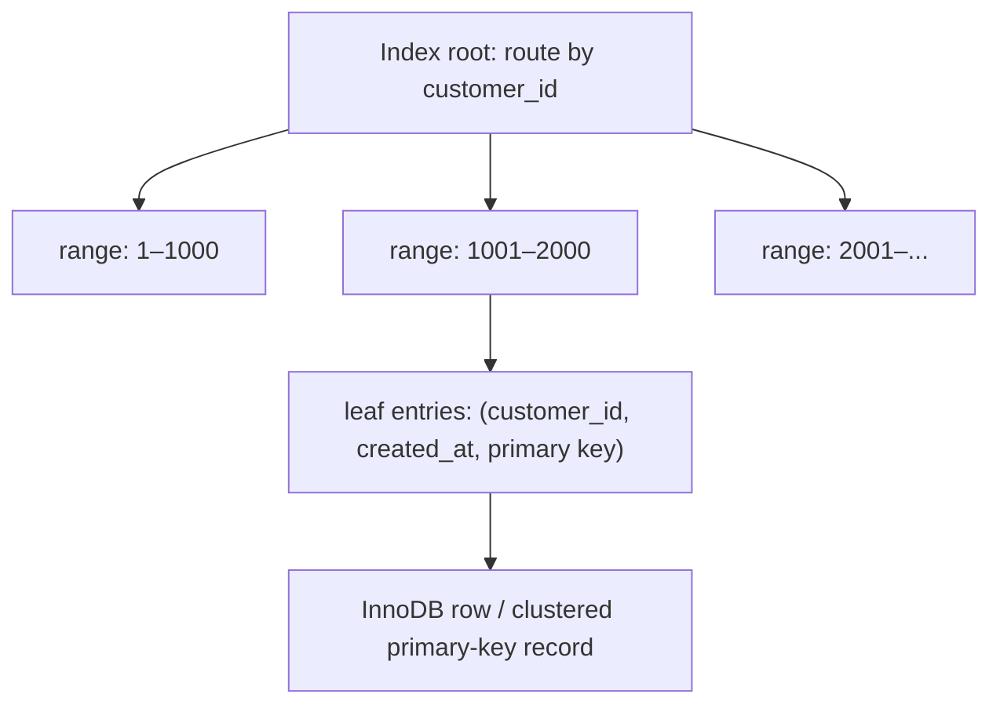

# 10 — Indexes, `EXPLAIN`, and performance engineering

Performance work starts with a real question and evidence. Do not add indexes because a column “sounds important.” An index speeds some reads by maintaining an ordered lookup structure; every index costs disk, memory, and write work.

## 1. B-tree intuition

The ordinary MySQL/InnoDB index is usually a B-tree: a balanced, ordered tree that lets MySQL jump near a value rather than inspect every row. InnoDB stores table data clustered by the primary key; secondary index entries point to the primary-key value.



The exact storage is more sophisticated than this drawing, but the idea helps: equality, ranges, prefix order, and selectivity determine usefulness.

## 2. Create indexes from queries

```sql
-- Common: recent orders for one customer
CREATE INDEX ix_orders_customer_created
  ON orders (customer_id, created_at DESC);

-- Common: paid orders in a date range
CREATE INDEX ix_orders_status_created
  ON orders (status, created_at);
```

A composite index `(customer_id, created_at)` is ordered first by `customer_id`, then by `created_at` inside each customer. It can support filters on `customer_id`, and on `customer_id` plus a range/order of `created_at`. It normally does not replace an index that must efficiently search by `created_at` alone: this is the **leftmost-prefix** principle.

Index order is a design decision. Equality filter columns often precede range columns; consider join columns and `ORDER BY`, but verify with `EXPLAIN`. Do not use rules mechanically.

## 3. Read an execution plan

```sql
EXPLAIN ANALYZE
SELECT order_id, created_at, status
FROM orders
WHERE customer_id = 42
  AND created_at >= '2026-08-01'
  AND created_at <  '2026-09-01'
ORDER BY created_at DESC
LIMIT 20;
```

`EXPLAIN` shows MySQL’s plan estimate. `EXPLAIN ANALYZE` executes the query and reports actual timing/row counts, so use it carefully on expensive production queries. Look for:

- **Access type / key:** is a useful index selected, or is it scanning the table?
- **Estimated versus actual rows:** big mismatch suggests stale statistics, correlation, or a poor plan.
- **Extra work:** sorting, temporary tables, or filtering may be acceptable, but understand why.
- **Join order:** MySQL may reorder tables; cardinality/indexes affect its choices.

Do not aim for a particular plan label. Aim to return the correct result within the latency/resource budget under realistic data volume.

## 4. Sargability: make predicates searchable

“Sargable” means a condition can use an index to seek a range effectively. Prefer a naked indexed column on one side of a comparison.

```sql
-- Usually poor: function must run for every candidate date.
WHERE DATE(created_at) = '2026-08-21'

-- Better: exact time range, can use an index on created_at.
WHERE created_at >= '2026-08-21'
  AND created_at <  '2026-08-22'

-- Usually poor for a normal B-tree index.
WHERE email LIKE '%@example.com'

-- Prefix search can use an appropriate normal index.
WHERE email LIKE 'ada%'
```

Avoid implicit type conversion too: compare a numeric key with a numeric parameter, and dates with date/datetime values. Wrapping an indexed column in `LOWER`, `CAST`, arithmetic, or arbitrary functions may prevent useful index access; use a suitable collation, generated column, or different predicate if needed.

## 5. Covering indexes and over-indexing

If a query can answer from index entries alone, it may avoid fetching base table rows: a **covering index**. For example, an index on `(customer_id, created_at, status)` can cover a query selecting just those fields. This can help, but wide indexes are costly. Add columns only after measuring.

Every additional index affects `INSERT`, `UPDATE`, and `DELETE`. Duplicated indexes waste resources. Inspect existing indexes:

```sql
SHOW INDEX FROM orders;
```

Before dropping an index, search application/report usage and compare plans. A unique constraint is often backed by an index; dropping it removes an integrity rule, not just a performance structure.

## 6. Query design is performance design

- Select required columns, not `SELECT *`, especially on wide/large result sets.
- Paginate deterministically; for deep paging, prefer a “seek” condition using the final values from the previous page.
- Aggregate at the needed grain; avoid joining huge child tables before filtering.
- Return summaries rather than raw event tables for dashboards when appropriate.
- Batch bulk writes; use transactions of a measured safe size.
- Avoid N+1 application queries: fetch relationships with a designed join/batch query.
- Use parameterized queries. They are safer and reduce statement parsing churn.

## 7. A scientific tuning loop

1. Capture the exact slow query, parameters, server/version, data scale, and desired latency.
2. Confirm correctness and output row count.
3. Run `EXPLAIN` and, safely, `EXPLAIN ANALYZE`.
4. Form one hypothesis: missing index, non-sargable filter, excessive rows, wrong join order, or schema issue.
5. Make one change in a test environment with production-like data.
6. Compare plan, elapsed time, rows examined, write cost, and concurrent behaviour.
7. Deploy with a rollback/monitoring plan; document why the index exists.

## 8. Advanced production notes

Large-table schema/index changes can be expensive and operationally risky. Learn your MySQL version’s online DDL capabilities, test lock/algorithm choices, plan a maintenance window or online-schema-change technique where needed, monitor replication lag, and always have a restore/rollback story. “It worked on my 10-row laptop table” is not a production benchmark.
