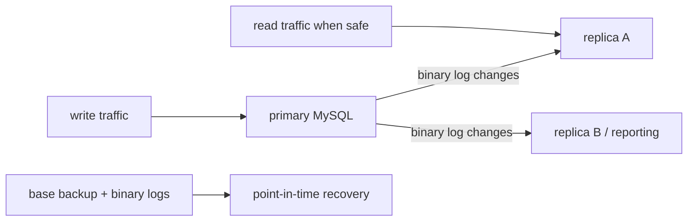

# 11 — Security, backups, recovery, replication, and operations

A database is not “done” once queries work. Data systems must be protected, recoverable, observable, and operated by least privilege.

## 1. Accounts are user + host

MySQL accounts are written as `'user'@'host'`. The host part controls where connections may come from. Create separate application accounts; do not make an application connect as `root`.

```sql
CREATE USER 'shop_app'@'10.0.0.%'
  IDENTIFIED BY 'use-a-secret-manager-not-this-literal';

GRANT SELECT, INSERT, UPDATE, DELETE
  ON shop.* TO 'shop_app'@'10.0.0.%';

SHOW GRANTS FOR 'shop_app'@'10.0.0.%';
```

This example illustrates syntax, not a password practice. Use a secret manager, TLS, firewall/network rules, and an exact allowed host/network. Grant only what the job needs. An application that only reads a reporting view should not have `DROP`, `ALTER`, `GRANT`, or broad table access.

Useful administration:

```sql
REVOKE DELETE ON shop.* FROM 'shop_app'@'10.0.0.%';
ALTER USER 'shop_app'@'10.0.0.%' IDENTIFIED BY 'rotated-secret';
DROP USER 'former_service'@'10.0.0.%';
```

Changing a password/privilege is an operational change: coordinate it with deployed applications, rotation, and rollback plans.

## 2. Security checklist

- Use individual/service accounts, strong authentication, and no shared root login.
- Use least privilege, preferably schema/table/view-specific grants.
- Require encrypted connections where traffic can leave a trusted local boundary.
- Protect backups equally or more carefully than live data; they often contain everything.
- Patch supported MySQL releases, OS, and client libraries according to change control.
- Log/audit privileged action where policy requires it; never log secrets or raw sensitive fields carelessly.
- Parameterize application SQL to stop injection. Permissions do not make unsafe string concatenation safe.
- Separate development, test, and production credentials/data; mask or synthesize non-production personal data.

## 3. Backup is a restore capability, not a file

A backup strategy answers: What loss is acceptable (**RPO**)? How fast must service recover (**RTO**)? What failures are covered: a deleted row, corrupted table, lost server, ransomware, region outage?

Common layers:

- **Logical backup:** exports SQL/data, e.g. `mysqldump`/MySQL Shell dump utilities. Portable and good for selected object restores; can be slower at large scale.
- **Physical backup:** copies database files consistently (often a dedicated backup tool/service). Faster for large instances; depends on version/storage details.
- **Binary logs + base backup:** enable point-in-time recovery: restore a base backup, then replay logs up to just before a mistake.
- **Replicas:** improve availability/read scaling but are not backups; a destructive change can replicate.

Example logical backup command (run from a secured host, not as a pasted shell history secret):

```powershell
mysqldump --single-transaction --routines --events --triggers `
  --databases shop > shop-2026-08-21.sql
```

`--single-transaction` can give a consistent snapshot for InnoDB without long table locking, but understand its limits and non-transactional tables. Secure/encrypt the output, restrict access, record server version, and monitor job success.

### Restore test

```powershell
mysql -u restore_user -p < shop-2026-08-21.sql
```

Never call a backup successful until you restore it into an isolated environment, validate schema/row counts/application queries, measure recovery time, and document the result. Test the scary case: recover an accidentally deleted row from a known time.

## 4. Operational observability

Monitor availability, connections, errors, disk/IOPS, CPU/memory, slow query rate/latency, buffer pool health, lock waits/deadlocks, backup age/outcome, replication lag, and available disk headroom. Alert on user impact and failure-risk trends, not every small fluctuation.

Useful inspection starts include:

```sql
SHOW PROCESSLIST;
SHOW GLOBAL STATUS LIKE 'Threads_connected';
SHOW GLOBAL STATUS LIKE 'Questions';
SHOW VARIABLES LIKE 'slow_query_log';
SHOW ENGINE INNODB STATUS;
```

Production diagnosis should use scoped, permissioned observability such as Performance Schema and the sys schema. Avoid exposing query text that contains customer data; parameterization helps here too.

## 5. Replication and high availability: mental model

A primary writes changes to the binary log. Replicas receive and apply those changes. This can support read scale, failover, analytics offload, and recovery design. It introduces lag and failover complexity: a replica may be behind, and a newly promoted writer needs an application routing plan.



Replication is advanced operational work. Learn GTIDs, row-based logging, replica monitoring, failover, consistency boundaries, and backup integration before operating it. Use managed services/established topology tools when they fit your organization.

## 6. Incident runbook mindset

When a harmful query occurs: stop additional damage if safe, capture exact times/query/account, do not perform improvised destructive “fixes,” assess whether a transaction can be rolled back, restore to an isolated place if needed, determine a precise repair/PITR plan, validate it, then communicate impact and prevention. Calm evidence beats hurried commands.

