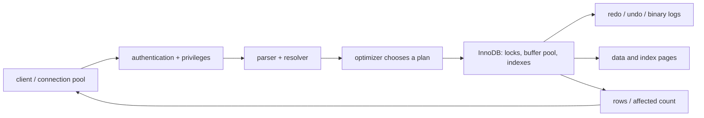

# 13 — MySQL architecture, storage engines, partitioning, and scaling

Understanding the server’s moving parts helps you diagnose slow, unsafe, or unavailable systems without superstition.

## 1. Server request path



The **parser** checks syntax. The **resolver** identifies tables/columns and verifies privileges. The **optimizer** estimates costs and chooses an execution plan. The storage engine reads/writes data. A client receives a result set or affected row count. A syntactically valid query can still be slow, incorrect for the business, or forbidden by permissions.

## 2. InnoDB essentials

Use InnoDB for normal transactional MySQL applications. It provides transactions, row-level locking, crash recovery, foreign keys, and MVCC (multi-version concurrency control). Its **buffer pool** caches frequently used data/index pages in memory. The primary key is clustered with table data, so choose a stable primary key and avoid changing it.

- **Redo log:** supports durable crash recovery for committed changes.
- **Undo data:** supports rollback and consistent reads of older row versions.
- **Binary log:** records changes for replication and point-in-time recovery; it is not the same as redo.
- **Doublewrite/change buffering/flush machinery:** implementation details that make durable page writes safer/efficient; tune only with workload evidence.

Use the default engine unless you have a specific, tested reason. `SHOW TABLE STATUS` and `SHOW CREATE TABLE` reveal a table’s engine. Mixing nontransactional tables into a transactional workflow changes its guarantees.

## 3. Character sets and collations

Character set controls what characters can be stored; collation controls comparison/sort behaviour. Prefer `utf8mb4` for new schemas. Collation choices determine whether `A` equals `a`, whether accents compare alike, and how sorting works. This affects unique keys too: two visually different strings may compare equal under a case/accent-insensitive collation.

```sql
SELECT @@character_set_server, @@collation_server;
SHOW FULL COLUMNS FROM customers;
```

Make text comparison requirements explicit. Do not “fix” an email uniqueness problem by applying `LOWER()` in every query without deciding what equality policy the product requires.

## 4. Partitioning: a large-table management tool

Partitioning splits one logical table into partitions, commonly by date or ID range. It can help prune irrelevant partitions and make retention operations such as dropping old time partitions fast. It is not an automatic speed switch: poor indexes, bad predicates, and skewed data remain poor.

```sql
CREATE TABLE audit_events (
  event_id BIGINT UNSIGNED NOT NULL,
  occurred_at DATETIME NOT NULL,
  actor_id BIGINT UNSIGNED NOT NULL,
  payload JSON NOT NULL,
  PRIMARY KEY (event_id, occurred_at)
)
PARTITION BY RANGE COLUMNS (occurred_at) (
  PARTITION p2026q1 VALUES LESS THAN ('2026-04-01'),
  PARTITION p2026q2 VALUES LESS THAN ('2026-07-01'),
  PARTITION p2026q3 VALUES LESS THAN ('2026-10-01'),
  PARTITION pmax    VALUES LESS THAN (MAXVALUE)
);
```

Partitioning has important key/unique-key restrictions, maintenance tasks, and query requirements. The partition key must match your retention/query shape. Test pruning with `EXPLAIN`, forecast partition creation, and never treat it as a replacement for archival policy/backups.

## 5. Scaling choices

Scale **up** first when it is simpler: more appropriate CPU, memory, fast storage, and a well-configured buffer pool. Scale **out** when a measured need remains:

- connection pooling reduces excessive server connections;
- read replicas can offload safe, lag-tolerant reads;
- caching reduces repeated expensive reads, with explicit invalidation/consistency policy;
- partitioning helps a specific large-table pattern;
- sharding splits data across independent databases, but creates major cross-shard query/transaction/operations complexity.

Before scaling infrastructure, remove waste: incorrect queries, missing indexes, unbounded results, N+1 application calls, unnecessary writes, and leaked connections. Benchmark a representative workload under concurrency.

## 6. Capacity questions to ask

How many rows/bytes per day? How long is retention? Which indexes multiply that size? What are peak read/write rates? Which latency percentile matters? How much concurrent traffic? How many connections are truly active? What recovery window is required? What is allowed to be stale? These answers drive schema, index, topology, and cost choices.

