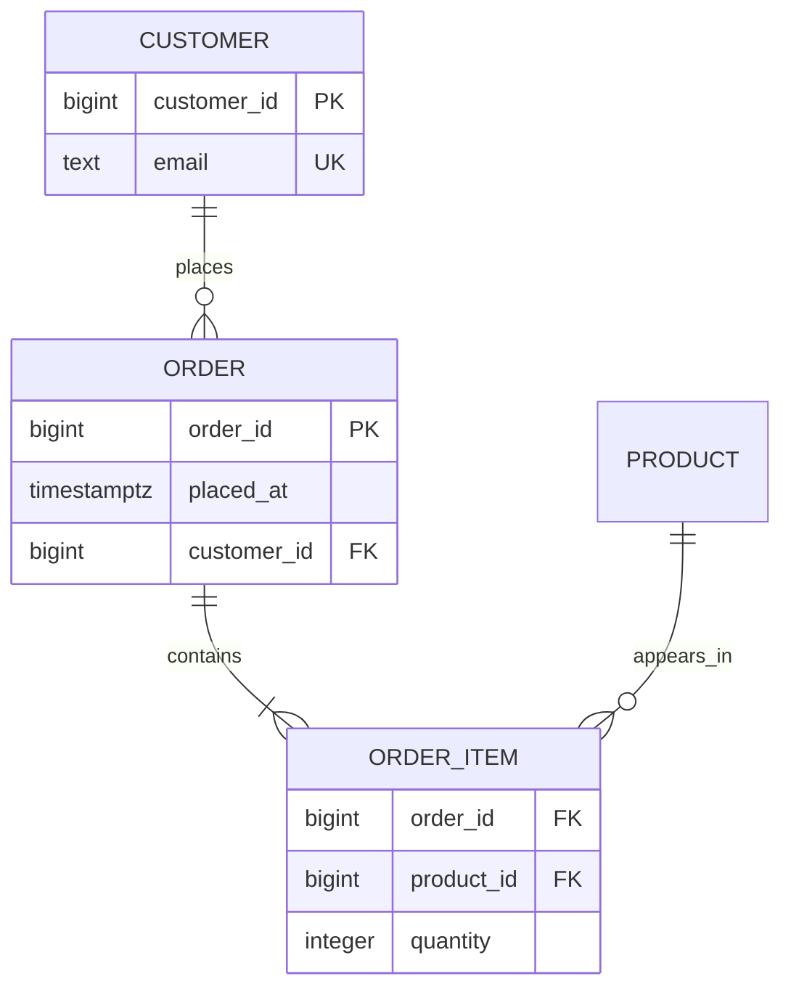
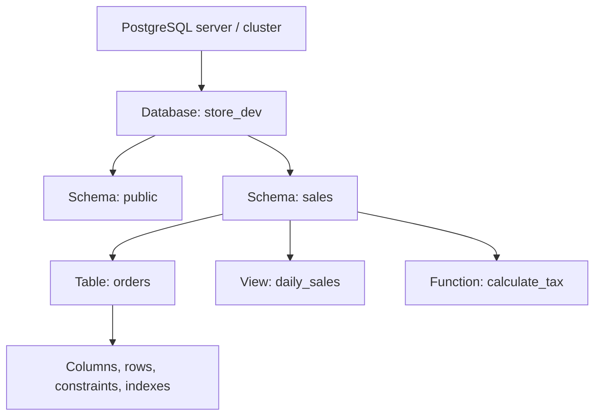

# 01 — Foundations: databases, SQL, and relational thinking

## 1. What is a database?

A **database** is an organized, persistent collection of related data. A spreadsheet can hold data, but a database adds rules, concurrent access, recovery, efficient search, permissions, and a language for asking questions.

Imagine an e-store. It must remember customers, products, orders, quantities, prices at the moment of purchase, stock, and payments. If the same customer name is copied into every order row, correcting a spelling or asking “how many orders did this customer place?” becomes unreliable. A database gives each fact a home and connects facts with identifiers.

## 2. Database vs DBMS vs RDBMS

| Term | Meaning | Example |
|---|---|---|
| Database | The data and its structure. | `store` database containing tables such as `orders`. |
| DBMS | Software that creates, stores, protects, and queries databases. | PostgreSQL, MySQL, Oracle, MongoDB. |
| RDBMS | A DBMS based on relations (tables) and relationships. | PostgreSQL, MySQL, SQL Server. |

A **relation** is the formal name for a table. A table has a fixed set of columns (attributes) and zero or more rows (tuples). Each row represents one fact of the same kind.



The lines are not decoration: they state business facts. A customer can place zero or many orders. An order item refers to one order and one product. Those claims must be represented by foreign keys and constraints, not merely assumed by application code.

## 3. Why relational databases remain important

Relational databases work well when correctness and relationships matter: banking, inventory, healthcare, school records, booking systems, SaaS products, and reporting. They offer:

- **Integrity:** keys, uniqueness, checks, and foreign keys reject invalid facts.
- **Transactions:** a group of changes becomes all-or-nothing.
- **SQL:** a declarative language: say *what* result you want, while the database chooses an efficient plan.
- **Concurrency:** many people can safely work at once.
- **Durability and recovery:** committed changes survive failure when operated correctly.

They are not the automatic answer for every workload. Key-value, document, graph, time-series, or search systems can be better for specific access patterns. A mature design begins with data shape, consistency needs, query patterns, latency, scale, and operating requirements—not fashion.

## 4. SQL vs PostgreSQL vs MySQL

**SQL** (Structured Query Language) is a standard language for defining and manipulating relational data. **PostgreSQL** and **MySQL** are database servers that implement SQL plus their own features and syntax choices. PostgreSQL is often called “Postgres.”

| Idea | Standard-ish SQL | PostgreSQL focus | MySQL contrast |
|---|---|---|---|
| Limit rows | `FETCH FIRST n ROWS ONLY` | also `LIMIT n` | commonly `LIMIT n` |
| Generated ID | identity column | `GENERATED ... AS IDENTITY` | `AUTO_INCREMENT` |
| Boolean | `BOOLEAN` | real `boolean` type | accepts `BOOLEAN` alias |
| Schema namespace | varies | first-class schemas | “database” often acts as schema |
| Advanced data | varies | arrays, ranges, JSONB, extensions | different feature set |

Do not learn a database by copying syntax blindly. Learn the relational ideas: identify entities, choose keys, preserve facts, and inspect query plans. Then check vendor documentation for the exact command.

## 5. The hierarchy in PostgreSQL



- A **server/cluster** is one running PostgreSQL installation that can host multiple databases.
- A **database** is an isolated named collection of schemas. You connect to one database at a time.
- A **schema** is a namespace inside a database, like a folder for database objects. `public` is the default schema.
- An **object** can be a table, view, sequence, function, type, index, and more.

Use `schema.table` in important SQL, for example `sales.orders`. It is explicit and avoids accidentally using an object selected through `search_path`.

## 6. Tables, rows, columns, and NULL

```sql
CREATE TABLE academy.student (
  student_id bigint GENERATED ALWAYS AS IDENTITY PRIMARY KEY,
  full_name  text NOT NULL,
  email      text NOT NULL UNIQUE,
  birth_date date,
  joined_at  timestamptz NOT NULL DEFAULT now()
);
```

Line-by-line:

1. `CREATE TABLE academy.student` makes a table named `student` in the `academy` schema.
2. `student_id ... IDENTITY` asks PostgreSQL to produce numeric IDs. `PRIMARY KEY` says it is the row’s unique, non-null identity.
3. `text` holds variable-length text. `NOT NULL` makes a name mandatory.
4. `UNIQUE` prohibits duplicate non-null email values.
5. A missing `birth_date` is allowed. It is unknown or not applicable—not an empty string.
6. `DEFAULT now()` evaluates when a row is inserted if the column is omitted.

`NULL` means “no known value” (or sometimes “not applicable”). It is not zero, false, an empty string, or a special date. SQL uses three-valued logic: true, false, and unknown. Therefore `birth_date = NULL` is never true; use `birth_date IS NULL`.

## 7. Declarative thinking: what, not how

```sql
SELECT full_name, email
FROM academy.student
WHERE joined_at >= date_trunc('month', now())
ORDER BY full_name;
```

Read it as: “Return name and email from students who joined this month, alphabetically.” You do **not** specify a loop. PostgreSQL can decide whether scanning the table or using an index is best. This separation is why good table design, statistics, and indexes affect query speed without changing query results.

## 8. Data lifecycle and command families

| Family | Purpose | Examples |
|---|---|---|
| DDL | Define data structures. | `CREATE`, `ALTER`, `DROP`, `TRUNCATE` |
| DML | Add/change/remove rows. | `INSERT`, `UPDATE`, `DELETE`, `MERGE` |
| DQL | Read data (often grouped under DML). | `SELECT` |
| DCL | Control permissions. | `GRANT`, `REVOKE` |
| TCL | Control transactions. | `BEGIN`, `COMMIT`, `ROLLBACK`, `SAVEPOINT` |

Every change has a blast radius. Before a DDL or DML statement, ask: Which database? Which schema? How many rows? How can I roll it back? What happens to concurrent users? Chapters 03, 04, and 09 turn these questions into habits.

## 9. Modeling before coding

For each requirement, write:

1. **Entities** — nouns that need independent identity: customer, order, product.
2. **Attributes** — facts about one entity: a customer’s email, product’s list price.
3. **Relationships** — verbs: customer *places* order; order *contains* product.
4. **Cardinality** — exactly one, zero or one, zero or many, one or many.
5. **Rules** — “quantity must be positive,” “email cannot repeat,” “order needs a customer.”
6. **Queries** — questions the application/report needs answered.

This process prevents a common beginner mistake: building a table around a screen rather than around durable facts. A screen can change; a well modeled fact survives.

## Checkpoint

Explain, without notes: the difference between a database and DBMS; why `NULL = NULL` is not true; why an order-item table exists; and why `WHERE col IS NULL` differs from `WHERE col = NULL`.
