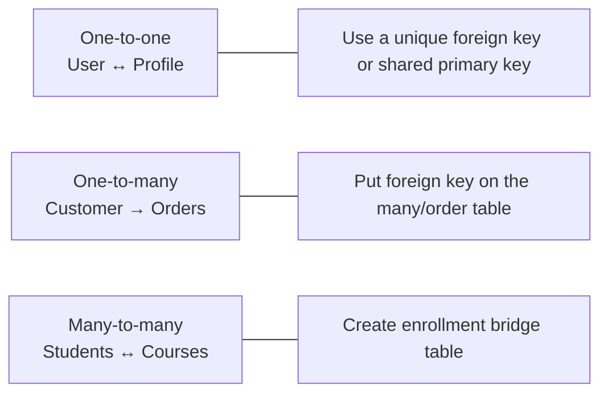
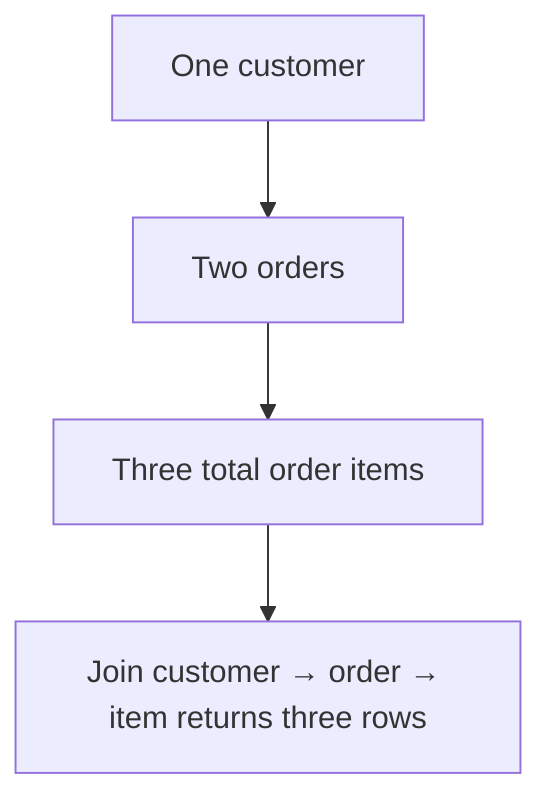

# 06 — Relationships, foreign keys, and joins

Relational design makes facts connect. A **foreign key** is a child column (or columns) whose value must point to an existing candidate key in a parent table. A **join** asks the database to combine matching rows at query time.

## 1. Cardinality: model the real-world rule



### One-to-one (1:1)

One-to-one is rarer than beginners expect. Use it when splitting a sensitive, optional, seldom-used, or separately owned set of attributes.

```sql
CREATE TABLE academy.student_profile (
  student_id bigint PRIMARY KEY
    REFERENCES academy.student(student_id) ON DELETE CASCADE,
  bio text,
  avatar_url text
);
```

The profile primary key is also a foreign key, so each student has at most one profile and each profile belongs to exactly one student. `ON DELETE CASCADE` says profile cannot make sense without its student. It is appropriate only when automatic removal is really the business rule.

### One-to-many (1:N)

```sql
CREATE TABLE academy.course_session (
  session_id bigint GENERATED ALWAYS AS IDENTITY PRIMARY KEY,
  course_id bigint NOT NULL REFERENCES academy.course(course_id),
  starts_at timestamptz NOT NULL,
  ends_at timestamptz NOT NULL,
  CHECK (ends_at > starts_at)
);
```

One course can have many sessions; each session refers to one required course. The foreign key belongs on the “many” side.

### Many-to-many (M:N)

Students can enroll in many courses and courses can have many students. Never put a comma-separated list of course IDs in `student`. Create a bridge relation:

```sql
CREATE TABLE academy.enrollment (
  student_id bigint NOT NULL REFERENCES academy.student(student_id),
  course_id  bigint NOT NULL REFERENCES academy.course(course_id),
  enrolled_at timestamptz NOT NULL DEFAULT now(),
  status text NOT NULL DEFAULT 'enrolled'
    CHECK (status IN ('enrolled', 'cancelled', 'completed')),
  PRIMARY KEY (student_id, course_id)
);
```

The bridge can store facts about the relationship itself: enrollment time, status, agreed price, role, rating. If it has a complex independent lifecycle, use a surrogate identity plus a `UNIQUE` constraint on the real uniqueness rule.

## 2. Foreign key actions: choose policy, do not guess

```sql
CREATE TABLE academy.submission (
  submission_id bigint GENERATED ALWAYS AS IDENTITY PRIMARY KEY,
  enrollment_student_id bigint NOT NULL,
  enrollment_course_id bigint NOT NULL,
  submitted_at timestamptz,
  FOREIGN KEY (enrollment_student_id, enrollment_course_id)
    REFERENCES academy.enrollment(student_id, course_id)
    ON DELETE RESTRICT
);
```

| Action | On parent delete/update, PostgreSQL... | Use when |
|---|---|---|
| `NO ACTION` (default) | checks at constraint-check time; may be deferred | parent cannot disappear while children remain. |
| `RESTRICT` | refuses immediately | same practical policy, explicitly immediate. |
| `CASCADE` | deletes/updates child references too | child has no meaningful independent existence. |
| `SET NULL` | changes child FK columns to null | relationship is optional and child still makes sense. |
| `SET DEFAULT` | uses child column default | only if default remains a valid reference. |

`ON DELETE CASCADE` is not a general convenience switch. Cascading from a customer through orders to payments or audit logs can erase information you were legally/operationally required to retain. Often a `deleted_at` soft-delete policy or explicit application workflow is better. Model retention policy separately.

## 3. Why joins can multiply rows



A join returns one result row for each matching combination. This is correct, not duplication. If you join one customer to two orders then to each order’s items, customer columns repeat once per item. Aggregate at the correct grain and diagnose unexpected row count increases before adding `DISTINCT`.

## 4. Inner join: only matched pairs

```sql
SELECT
  s.full_name,
  c.course_code,
  e.enrolled_at
FROM academy.enrollment AS e
JOIN academy.student AS s
  ON s.student_id = e.student_id
JOIN academy.course AS c
  ON c.course_id = e.course_id
ORDER BY e.enrolled_at DESC;
```

`JOIN` means `INNER JOIN` by default. It removes rows that find no match. Write the join condition in `ON`; use `WHERE` for filters that apply after matches are formed.

## 5. Left join: preserve every left row

```sql
SELECT
  c.course_code,
  count(e.student_id) AS enrollment_count
FROM academy.course AS c
LEFT JOIN academy.enrollment AS e
  ON e.course_id = c.course_id
GROUP BY c.course_id, c.course_code
ORDER BY c.course_code;
```

`LEFT JOIN` keeps every course. A course with no enrollment receives null-extended enrollment columns. Count `e.student_id`, not `count(*)`: the left-join placeholder is still one output row, whereas the child key is null.

### A frequent left join bug

```sql
-- BUG: WHERE rejects NULL child rows, effectively becoming an inner join.
SELECT c.course_code
FROM academy.course AS c
LEFT JOIN academy.enrollment AS e ON e.course_id = c.course_id
WHERE e.status = 'completed';

-- Correct when you want all courses and only completed children counted.
SELECT c.course_code, count(e.student_id) AS completed_count
FROM academy.course AS c
LEFT JOIN academy.enrollment AS e
  ON e.course_id = c.course_id
 AND e.status = 'completed'
GROUP BY c.course_id, c.course_code;
```

Put a right-table filter in the `ON` clause when it must not remove unmatched left rows. Use a `WHERE` null test intentionally when the goal is an anti-join.

```sql
-- Courses with no enrollments.
SELECT c.course_code
FROM academy.course AS c
LEFT JOIN academy.enrollment AS e ON e.course_id = c.course_id
WHERE e.course_id IS NULL;
```

`NOT EXISTS` expresses that final question even more directly.

## 6. Right, full, cross, and self joins

| Join | Result | Practical advice |
|---|---|---|
| `RIGHT JOIN` | preserves every right row | Rewrite as a `LEFT JOIN` by swapping table order; easier to read. |
| `FULL OUTER JOIN` | preserves nonmatches from both sides | Good for reconciliation reports; handle nulls explicitly. |
| `CROSS JOIN` | every left row paired with every right row | Use deliberately for small dimension grids; row count is left × right. |
| Self join | table joined to itself | Use for hierarchy/comparison with distinct aliases. |

```sql
-- Cross join creates every student/course pair: do this only intentionally.
SELECT s.full_name, c.course_code
FROM academy.student AS s
CROSS JOIN academy.course AS c;

-- Self join: employee/manager (sample shape).
SELECT e.full_name AS employee, m.full_name AS manager
FROM company.employee AS e
LEFT JOIN company.employee AS m ON m.employee_id = e.manager_id;
```

## 7. Join predicates and data types

Join keys should have compatible types and represent the same domain. Do not join `text` code to a numeric key via repeated casts; fix the model/import. Avoid joining with expressions such as `lower(email) = lower(email)` unless you have intentionally designed a normalized/indexed expression. A foreign key ensures referential integrity but does **not** automatically index the child key in PostgreSQL—add an index when parent deletes/updates or joins need it (chapter 09).

## 8. Joining aggregate results at the correct grain

```sql
WITH course_counts AS (
  SELECT course_id, count(*) AS enrollment_count
  FROM academy.enrollment
  GROUP BY course_id
)
SELECT c.course_code, c.title, coalesce(cc.enrollment_count, 0) AS enrollment_count
FROM academy.course AS c
LEFT JOIN course_counts AS cc ON cc.course_id = c.course_id;
```

Aggregate `enrollment` to one row per course before joining to `course`. This avoids accidentally multiplying the aggregate when later joins add another one-to-many relationship.

## Relationship design lab

Design a library model with `member`, `book`, `author`, `book_author`, `copy`, and `loan`.

1. Identify each primary key and all foreign keys.
2. Explain why book-author needs a bridge table.
3. Decide which deletions should be restricted, cascaded, or represented as a soft delete.
4. Write a query returning every book with its number of currently available copies, including books with zero copies.
5. Explain the expected row count of joining `book → book_author → author` when one book has three authors.
