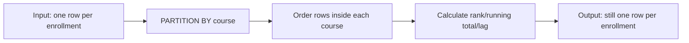

# 07 — Advanced query patterns: CTEs, windows, views, JSON, and search

Advanced SQL lets you express complex questions in one clear, testable statement. Use it to make logic *more legible*, not to impress someone with dense code.

## 1. CTEs: name intermediate relations

A **common table expression (CTE)** begins with `WITH`. Think of it as a named, temporary result available only to the statement that follows.

```sql
WITH completed AS (
  SELECT course_id, student_id, final_score
  FROM academy.enrollment
  WHERE completed_at IS NOT NULL
), course_averages AS (
  SELECT course_id, avg(final_score) AS average_score
  FROM completed
  GROUP BY course_id
)
SELECT c.course_code, ca.average_score
FROM course_averages AS ca
JOIN academy.course AS c ON c.course_id = ca.course_id
ORDER BY ca.average_score DESC NULLS LAST;
```

Read it top-down: first name completed enrollments; then calculate one average per course; then attach human-readable course data. PostgreSQL may inline or materialize a non-recursive CTE depending on version/cost. A CTE is not automatically a performance optimization. Use `MATERIALIZED` or `NOT MATERIALIZED` only after measuring and understanding the plan.

### Data-changing CTEs

```sql
WITH moved AS (
  DELETE FROM academy.enrollment
  WHERE status = 'cancelled' AND enrolled_at < now() - interval '2 years'
  RETURNING *
)
INSERT INTO academy.enrollment_archive
SELECT *, now() AS archived_at
FROM moved;
```

This single statement moves rows atomically. Use explicit column lists in a real migration and test retention rules carefully.

## 2. Window functions: compute without collapsing rows

`GROUP BY` reduces many rows to one row per group. A **window function** calculates over related rows while preserving each original row.

```sql
SELECT
  course_id,
  student_id,
  final_score,
  avg(final_score) OVER (PARTITION BY course_id) AS course_average,
  rank() OVER (PARTITION BY course_id ORDER BY final_score DESC NULLS LAST) AS score_rank
FROM academy.enrollment;
```

`PARTITION BY course_id` creates one logical window per course. `ORDER BY` inside `OVER` determines sequence/rank—it does **not** determine final output order. Add an outer `ORDER BY` for display.



### Ranking functions

| Function | Tie behavior | Values after a tie |
|---|---|---|
| `row_number()` | arbitrarily distinguishes ties unless order is unique | 1, 2, 3 |
| `rank()` | equal values share rank | gaps: 1, 1, 3 |
| `dense_rank()` | equal values share rank | no gaps: 1, 1, 2 |
| `ntile(n)` | divides ordered partition into roughly n buckets | bucket number |

To retain exactly the latest row per student, ensure a deterministic tiebreaker:

```sql
WITH ranked AS (
  SELECT e.*,
         row_number() OVER (
           PARTITION BY student_id
           ORDER BY enrolled_at DESC, course_id DESC
         ) AS rn
  FROM academy.enrollment AS e
)
SELECT *
FROM ranked
WHERE rn = 1;
```

You cannot normally use a window function directly in the same query’s `WHERE`, because windows logically happen after `WHERE`. Put the result in a subquery/CTE, then filter.

### Running totals and frames

```sql
SELECT
  course_id,
  enrolled_at::date AS day,
  count(*) AS daily_enrollments,
  sum(count(*)) OVER (
    PARTITION BY course_id
    ORDER BY enrolled_at::date
    ROWS BETWEEN UNBOUNDED PRECEDING AND CURRENT ROW
  ) AS running_enrollments
FROM academy.enrollment
GROUP BY course_id, enrolled_at::date;
```

The inner `count(*)` creates daily rows. The windowed `sum` then accumulates those daily counts. `ROWS` means physical rows in ordered output; `RANGE` groups peers with the same order value in ways that can surprise you. Specify a frame when the default is not exactly your desired meaning.

### `lag` and `lead`: compare neighboring rows

```sql
SELECT
  student_id,
  enrolled_at,
  enrolled_at - lag(enrolled_at) OVER (
    PARTITION BY student_id
    ORDER BY enrolled_at
  ) AS time_since_previous_enrollment
FROM academy.enrollment;
```

The first row of each student has no previous row, so the difference is NULL. Supply a third argument to `lag` only if a default truly has meaning.

## 3. Recursive CTEs: traverse hierarchies

```sql
WITH RECURSIVE org_tree AS (
  -- Anchor: top-level employees.
  SELECT employee_id, full_name, manager_id, 0 AS depth,
         ARRAY[employee_id] AS path
  FROM company.employee
  WHERE manager_id IS NULL

  UNION ALL

  -- Recursive member: each child of rows already found.
  SELECT e.employee_id, e.full_name, e.manager_id, t.depth + 1,
         t.path || e.employee_id
  FROM company.employee AS e
  JOIN org_tree AS t ON e.manager_id = t.employee_id
  WHERE NOT e.employee_id = ANY(t.path) -- cycle guard
)
SELECT * FROM org_tree ORDER BY path;
```

A recursive CTE has an anchor query and a recursive query joined with `UNION ALL`. Each iteration uses prior results until no rows remain. Always consider cycles, depth limits, and result size. PostgreSQL 14+ also supports `SEARCH` and `CYCLE` clauses for structured traversal/cycle detection.

## 4. Views and materialized views

```sql
CREATE VIEW academy.course_enrollment_summary AS
SELECT
  c.course_id,
  c.course_code,
  c.title,
  count(e.student_id) AS enrollment_count,
  count(*) FILTER (WHERE e.completed_at IS NOT NULL) AS completed_count
FROM academy.course AS c
LEFT JOIN academy.enrollment AS e ON e.course_id = c.course_id
GROUP BY c.course_id, c.course_code, c.title;
```

A **view** stores a query definition, not copied results. It provides a reusable semantic interface, simplifies controlled access, and can hide joins/columns. It does not automatically make a query fast.

```sql
CREATE MATERIALIZED VIEW academy.monthly_enrollment_summary AS
SELECT date_trunc('month', enrolled_at) AS month, course_id, count(*) AS enrollments
FROM academy.enrollment
GROUP BY 1, 2;

REFRESH MATERIALIZED VIEW academy.monthly_enrollment_summary;
```

A **materialized view** stores query results physically. Reads can be fast, but results become stale until refresh. `REFRESH ... CONCURRENTLY` allows reads during refresh but requires a suitable unique index and has operational tradeoffs. Decide freshness requirement first.

## 5. JSON and JSONB (PostgreSQL)

`json` preserves input text; `jsonb` stores a parsed binary format that supports indexing and generally fits application data better. Neither automatically validates document shape.

```sql
CREATE TABLE academy.event_log (
  event_id bigint GENERATED ALWAYS AS IDENTITY PRIMARY KEY,
  occurred_at timestamptz NOT NULL DEFAULT now(),
  event_type text NOT NULL,
  payload jsonb NOT NULL CHECK (jsonb_typeof(payload) = 'object')
);

INSERT INTO academy.event_log (event_type, payload)
VALUES ('student_registered',
        '{"student_id": 42, "source": "website", "campaign": "august"}');

SELECT
  payload -> 'student_id' AS json_value,
  payload ->> 'source' AS text_value
FROM academy.event_log
WHERE payload @> '{"source":"website"}';
```

- `->` returns JSON/JSONB; `->>` returns text.
- `@>` tests containment.
- Use `jsonb_build_object`, `jsonb_agg`, and `jsonb_array_elements` to create/read documents.

Use normalized columns and tables for facts you filter/join/constrain frequently. JSONB is good for sparse, variable metadata or externally shaped payloads. A common robust design has standard relational columns for core fields and a JSONB metadata column with documented ownership/validation.

## 6. Full-text search (FTS)

`LIKE '%word%'` is substring search. Full-text search tokenizes text, normalizes words, and ranks matches.

```sql
ALTER TABLE academy.course
ADD COLUMN search_document tsvector GENERATED ALWAYS AS (
  setweight(to_tsvector('english', coalesce(title, '')), 'A') ||
  setweight(to_tsvector('english', coalesce(description, '')), 'B')
) STORED;

CREATE INDEX course_search_document_gin_idx
ON academy.course USING gin (search_document);

SELECT course_code, title,
       ts_rank(search_document, websearch_to_tsquery('english', 'postgres performance')) AS rank
FROM academy.course
WHERE search_document @@ websearch_to_tsquery('english', 'postgres performance')
ORDER BY rank DESC, course_id;
```

`tsvector` is the indexed document; `tsquery` is the query; `@@` means matches. Pick the text configuration/language intentionally. `websearch_to_tsquery` is friendly for simple user search input, but treat search syntax as a product requirement and test it.

## 7. LATERAL joins

`LATERAL` lets a subquery in `FROM` refer to earlier tables. It is useful for “top N related rows for each parent.”

```sql
SELECT s.full_name, latest.course_id, latest.enrolled_at
FROM academy.student AS s
LEFT JOIN LATERAL (
  SELECT course_id, enrolled_at
  FROM academy.enrollment AS e
  WHERE e.student_id = s.student_id
  ORDER BY enrolled_at DESC, course_id DESC
  LIMIT 1
) AS latest ON true;
```

Without `LATERAL`, the subquery cannot see `s.student_id`. This can be elegant with an index on `(student_id, enrolled_at DESC)`; always inspect performance at realistic scale.

## Advanced SQL lab

1. Use a CTE to calculate each course’s completion rate and rank courses by it.
2. Return the top two scores per course, keeping ties; explain `rank` vs `row_number`.
3. Find each student’s gap between first and second enrollment with `lead` or `lag`.
4. Create a view that exposes course title and completion rate but not raw learner email.
5. Add a JSONB `metadata` column to a practice table, validate it is an object, and create a query for a nested property.
