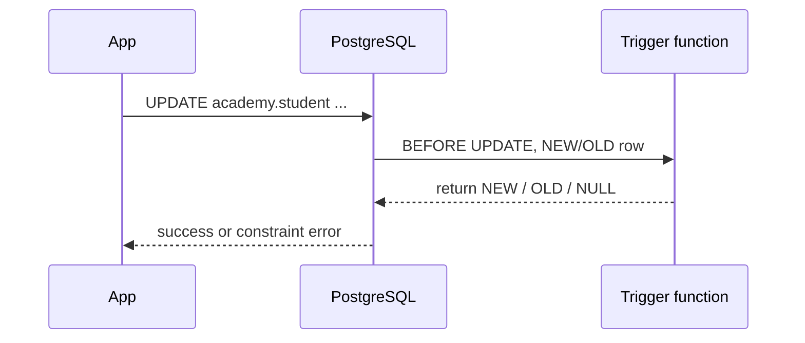

# 08 — Functions, procedures, and triggers

Database code can centralize carefully chosen rules near the data. It can also become hidden, hard-to-test application logic. The goal is not “put everything in the database”; it is to place integrity, security, and data-local work where they are most reliable and visible.

## 1. Functions versus procedures

| Feature | Function | Procedure |
|---|---|---|
| Invocation | expression or `SELECT` | `CALL` |
| Returns a value | yes (scalar, row, set, table) | no direct return value; can use `OUT` parameters |
| Transaction control inside body | cannot `COMMIT`/`ROLLBACK` when called as function | can manage transactions in appropriate `CALL` contexts |
| Typical use | calculation, data API, reusable query | administrative/batch workflow |

Use a function when the task is naturally a value or relation: `calculate_tax(amount)`, `active_students(course_id)`. Use a procedure for an explicit workflow that may need transaction control. Keep APIs small, named clearly, versioned with migrations, and secured with least privilege.

## 2. SQL-language function: concise and safe for a query

```sql
CREATE OR REPLACE FUNCTION academy.course_enrollment_count(p_course_id bigint)
RETURNS bigint
LANGUAGE sql
STABLE
AS $$
  SELECT count(*)
  FROM academy.enrollment
  WHERE course_id = p_course_id;
$$;

SELECT academy.course_enrollment_count(1);
```

Line-by-line:

1. `CREATE OR REPLACE` creates or replaces the function body while keeping its identity/signature. It does not magically migrate callers to a changed signature.
2. Parameter prefix `p_` makes it distinguishable from column names.
3. `RETURNS bigint` declares the result type.
4. `LANGUAGE sql` means the body is SQL, not procedural code.
5. `STABLE` promises the function returns the same result for same arguments within one statement. PostgreSQL can use this information to plan queries. Mark volatility honestly.
6. `$$` dollar-quotes the body, avoiding escaped single quotes.

### Function volatility matters

| Declaration | Promise | Example |
|---|---|---|
| `IMMUTABLE` | same arguments always yield same result | pure mathematical/text transformation |
| `STABLE` | same within one statement; may change later | lookup/query of tables, `current_date` |
| `VOLATILE` (default) | can change each call or have side effects | `random()`, writes, `clock_timestamp()` |

Do not label a function `IMMUTABLE` to force an index. A false promise can produce incorrect results.

## 3. PL/pgSQL function: control flow and validation

```sql
CREATE OR REPLACE FUNCTION academy.grade_label(p_score numeric)
RETURNS text
LANGUAGE plpgsql
IMMUTABLE
AS $$
BEGIN
  IF p_score IS NULL THEN
    RETURN 'ungraded';
  ELSIF p_score >= 90 THEN
    RETURN 'excellent';
  ELSIF p_score >= 40 THEN
    RETURN 'pass';
  ELSE
    RETURN 'fail';
  END IF;
END;
$$;
```

`plpgsql` has variables, `IF`, loops, exceptions, and dynamic SQL. It is powerful, but set-based SQL is normally simpler and faster than looping one row at a time. First ask whether a single `INSERT ... SELECT`, `UPDATE ... FROM`, CTE, aggregate, or window function already expresses the task.

## 4. Return a set of rows

```sql
CREATE OR REPLACE FUNCTION academy.students_in_course(p_course_id bigint)
RETURNS TABLE (
  student_id bigint,
  full_name text,
  enrolled_at timestamptz
)
LANGUAGE sql
STABLE
AS $$
  SELECT s.student_id, s.full_name, e.enrolled_at
  FROM academy.enrollment AS e
  JOIN academy.student AS s ON s.student_id = e.student_id
  WHERE e.course_id = p_course_id
  ORDER BY e.enrolled_at;
$$;

SELECT * FROM academy.students_in_course(1);
```

Set-returning functions are useful internal APIs, but a view or parameterized application query is sometimes clearer. Index the underlying tables, because wrapping a query in a function does not remove its cost.

## 5. Procedures and `OUT` parameters

```sql
CREATE OR REPLACE PROCEDURE academy.deactivate_old_courses(
  IN p_cutoff date,
  OUT p_changed_count integer
)
LANGUAGE plpgsql
AS $$
BEGIN
  UPDATE academy.course
  SET active = false
  WHERE active = true
    AND created_at::date < p_cutoff;

  GET DIAGNOSTICS p_changed_count = ROW_COUNT;
END;
$$;

CALL academy.deactivate_old_courses(DATE '2024-01-01', NULL);
```

The `OUT` parameter returns one output field. In production, “deactivate” should be a documented business policy; `created_at` may not be the correct indicator of course freshness. The point is structure: validate inputs, make a set-based change, capture a result, and expose a predictable contract.

## 6. Trigger anatomy

A **trigger** automatically runs a trigger function when an event occurs on a table: `INSERT`, `UPDATE`, `DELETE`, or `TRUNCATE`. It can run `BEFORE`, `AFTER`, or `INSTEAD OF` (for views), per row or per statement.



### Example: reliable `updated_at`

```sql
CREATE OR REPLACE FUNCTION academy.set_updated_at()
RETURNS trigger
LANGUAGE plpgsql
AS $$
BEGIN
  NEW.updated_at := now();
  RETURN NEW;
END;
$$;

CREATE TRIGGER student_set_updated_at
BEFORE UPDATE ON academy.student
FOR EACH ROW
EXECUTE FUNCTION academy.set_updated_at();
```

`NEW` is the proposed inserted/updated row; `OLD` is the prior updated/deleted row. A `BEFORE ... FOR EACH ROW` trigger generally returns `NEW` to continue, or `NULL` to skip that row. An `AFTER` trigger’s return value is ignored.

Add the column first:

```sql
ALTER TABLE academy.student
ADD COLUMN updated_at timestamptz NOT NULL DEFAULT now();
```

## 7. Auditing with a trigger (carefully)

```sql
CREATE TABLE academy.student_audit (
  audit_id bigint GENERATED ALWAYS AS IDENTITY PRIMARY KEY,
  changed_at timestamptz NOT NULL DEFAULT now(),
  changed_by text NOT NULL DEFAULT current_user,
  operation text NOT NULL,
  old_row jsonb,
  new_row jsonb
);

CREATE OR REPLACE FUNCTION academy.audit_student_change()
RETURNS trigger
LANGUAGE plpgsql
AS $$
BEGIN
  INSERT INTO academy.student_audit (operation, old_row, new_row)
  VALUES (TG_OP,
          CASE WHEN TG_OP IN ('UPDATE', 'DELETE') THEN to_jsonb(OLD) END,
          CASE WHEN TG_OP IN ('INSERT', 'UPDATE') THEN to_jsonb(NEW) END);
  RETURN COALESCE(NEW, OLD);
END;
$$;

CREATE TRIGGER student_audit
AFTER INSERT OR UPDATE OR DELETE ON academy.student
FOR EACH ROW EXECUTE FUNCTION academy.audit_student_change();
```

Trigger metadata includes `TG_OP`, `TG_TABLE_SCHEMA`, and more. Audit tables grow quickly, can expose sensitive information, and need retention/access policy. In high-throughput systems, an application event/outbox design or logical decoding may be more appropriate. Audit needs should be designed, not added casually.

## 8. Trigger cautions and alternatives

Use a trigger when a rule must hold for **every** writer and cannot be expressed by declarative constraints, generated columns, a view, or a clear transaction/query. Avoid triggers for hidden cross-table “magic,” network calls, nondeterministic work, or expensive per-row loops.

Prefer, in order where suitable:

1. type / `NOT NULL` / default / check / unique / foreign key;
2. generated column or index expression;
3. a single explicit set-based statement or transaction;
4. a documented function/procedure;
5. a narrow, tested trigger.

Trigger functions run inside the triggering transaction. If they fail, the original data change fails. Multiple triggers of the same kind execute alphabetically by name—do not make correctness depend on mysterious ordering.

## 9. Dynamic SQL and security

Use `EXECUTE format(...)` only when object names or query structure genuinely must vary. Values must be parameterized with `USING`; identifiers must use `%I`; literals use `%L` only when parameters cannot apply.

```sql
-- Inside PL/pgSQL; identifier safely quoted, value parameterized.
EXECUTE format('SELECT count(*) FROM %I.%I WHERE course_id = $1', p_schema, p_table)
  INTO p_count
  USING p_course_id;
```

Never concatenate raw input into dynamic SQL. Be extremely cautious with `SECURITY DEFINER` functions: set a safe `search_path`, use schema-qualified objects, grant execute only as needed, and have a security review. A definer function can accidentally become a privilege-escalation path.

## Routine lab

1. Write an immutable SQL function that returns a normalized course code using trim and upper.
2. Write a set-returning function for active courses below a maximum price.
3. Add an `updated_at` column and trigger to a disposable table; prove inserts do not change it but updates do.
4. Replace a row-by-row loop with one set-based update.
5. Explain why an order-total trigger can be risky under concurrent item changes and how a query/view can avoid stored redundancy.
