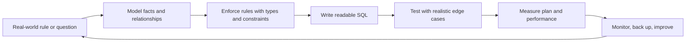

# PostgreSQL: Beginner-to-Master Handbook

**How to use this handbook:** Work through the chapters in order. Type every SQL statement yourself, change values deliberately, read errors, and complete the labs without looking at solutions first. PostgreSQL is learned by *asking data questions*, not by memorising commands.

This is a PostgreSQL-first course. It covers every core topic in the supplied MySQL/PostgreSQL syllabus and extends it with transactions, indexing, query planning, isolation, security, backups, JSON, full-text search, partitioning, and production habits. Most standard SQL is portable; syntax marked **PostgreSQL** is specific to PostgreSQL.

## Learning path

| Stage | Read | Outcome |
|---|---|---|
| 0. Mental model | [01 Foundations](01-foundations.md) | Understand databases, DBMS/RDBMS, SQL, schemas, and relational design. |
| 1. Start safely | [02 Installation and tools](02-installation-and-tools.md) | Install PostgreSQL, use `psql`/pgAdmin, create and connect to databases. |
| 2. Build and change data | [03 SQL and CRUD](03-sql-crud.md) | Define tables and perform safe `INSERT`, `SELECT`, `UPDATE`, and `DELETE`. |
| 3. Make data valid | [04 Types, constraints, and DDL](04-types-constraints-ddl.md) | Choose types, keys, defaults, checks, and alter tables safely. |
| 4. Ask excellent questions | [05 Querying and aggregation](05-querying-and-aggregation.md) | Filter, sort, group, use strings/dates, CASE, subqueries, and set operations. |
| 5. Model real systems | [06 Relationships and joins](06-relationships-and-joins.md) | Design 1:1, 1:N, M:N models and write joins. |
| 6. Think analytically | [07 Advanced query patterns](07-advanced-query-patterns.md) | Use CTEs, window functions, recursive queries, views, JSON, and full-text search. |
| 7. Automate correctly | [08 Routines and triggers](08-routines-and-triggers.md) | Write functions, procedures, and narrowly scoped triggers. |
| 8. Run production workloads | [09 Transactions, performance, and operations](09-transactions-performance-operations.md) | Use ACID, locks, indexes, `EXPLAIN`, roles, backups, and migrations. |
| 9. Combine everything | [10 Capstone e-store](10-capstone-e-store.md) | Build a secure, queryable e-commerce database. |
| 10. Prove mastery | [11 Mastery labs](11-mastery-labs.md) | Complete progressive labs, debugging drills, and interview tasks. |
| Beyond the core | [12 PostgreSQL advanced toolbox](12-postgresql-advanced-toolbox.md) | Apply ranges, extensions, partitioning, replication concepts, and diagnostics deliberately. |

## The loop behind every good database decision

## Companion files

- [lab-schema.sql](lab-schema.sql) creates a clean `academy` practice schema and seed data used by examples.
- [quick-reference.md](quick-reference.md) is a compact syntax and troubleshooting card.
- [solutions.md](solutions.md) has selected lab solutions; use it only after attempting the lab.

## Ground rules before you run SQL

1. Use a disposable practice database. Never test `UPDATE`, `DELETE`, or schema changes on production data.
2. Put a `WHERE` clause on `UPDATE` and `DELETE`, preview the target rows with `SELECT`, and use a transaction for risky work.
3. A table stores one kind of fact. A column stores one attribute. A row is one occurrence of that fact.
4. Constraints protect data even when an application has a bug. Application validation is useful, but it is not a replacement.
5. PostgreSQL folds **unquoted** identifiers to lowercase. Prefer `snake_case` names and avoid quoted mixed-case names.
6. Store timestamps as `timestamptz` for real-world moments; store a `date` or `time` only when that is the actual fact.

## What “mastery” looks like

You can turn a plain-English requirement into a normalized schema; defend each type/key/constraint; write and explain a query without trial-and-error; investigate a slow query with `EXPLAIN (ANALYZE, BUFFERS)`; reason about concurrent updates; and restore a tested backup. Syntax is only the entry point.

> **Version note:** Examples target PostgreSQL 16+. Minor syntax differences exist across releases; consult the official PostgreSQL documentation for your installed version when operating a production system.
